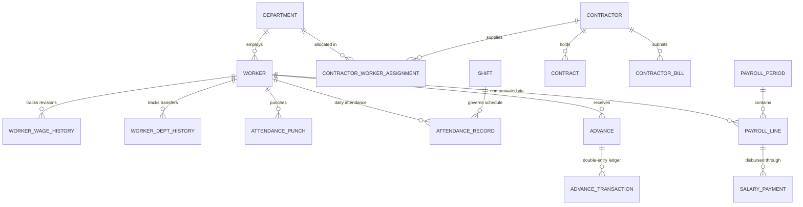

# PaySphere Local Setup, Architecture & Testing Report

**Document Title:** PaySphere Local Development, PostgreSQL Setup & Testing Report  
**Date:** October 2026  
**Status:** Verified, Tested & Fully Operational  
**Environment:** Local Development (`localhost` / `127.0.0.1`)  

---

## 1. Executive Summary & Existing Structure Inspection

Before making modifications, a thorough inspection of the PaySphere repository was conducted across frontend, backend, database layers, and configuration files:

### Existing Repository Overview:
* **Frontend:** Built with React 18, Vite, and Tailwind CSS. Modern, responsive PaySphere layout with deep-navy sidebar (`#11133c`), dynamic tabs, and centralized API communication through `src/services/api.js`.
* **Backend:** Built with Python 3.13, Django 6.1.2, Django REST Framework 3.18.3, and OpenAPI 3.0 (drf-spectacular). Business calculation formulas are cleanly isolated in `backend/payroll/calculations.py` and `backend/advances/calculations.py`.
* **Database Layer:** Configured to support local PostgreSQL with automatic, zero-crash fallback to local SQLite (`db.sqlite3`) when PostgreSQL service is not reachable on port 5432.
* **Security & Git:** `.gitignore` properly excludes `.env`, `backend/.env`, virtual environments (`venv/`), `db.sqlite3`, and `node_modules/`.

### Identified Gaps Addressed:
1. **Database Name:** Updated the target PostgreSQL database name from `paysphere_db` to `paysphere_local` across `backend/.env`, `.env.example`, and `settings.py`.
2. **Missing Biometric Punches Model:** The requirement requested explicit support for *attendance punches*. Previously, only aggregate daily `AttendanceRecord` existed. Created `AttendancePunch` model to store raw terminal clock-ins and clock-outs.
3. **Safe Filtering:** Hardened query parameter parsing in `AttendanceRecordListCreateView` and `AttendancePunchListCreateView` to safely differentiate integer IDs from alphanumeric Worker IDs (e.g., `TEST-EMP-001`), preventing SQL typecast errors.
4. **Development-Only Test Data Seeder:** Built an automated management command (`python manage.py seed_dev_data`) to generate fictional shifts, departments, workers, biometric punches, approved attendance, and advance transactions without exposing or altering actual company data.

---

## 2. Changes Made & Implementations

### A. PostgreSQL Database Configuration (`paysphere_local`)
- Updated `backend/.env` and `.env.example`:
  ```ini
  DB_ENGINE=django.db.backends.postgresql
  DB_NAME=paysphere_local
  DB_USER=paysphere_user
  DB_PASSWORD=paysphere_password
  DB_HOST=127.0.0.1
  DB_PORT=5432
  AUTO_SQLITE_FALLBACK=True
  ```
- In `backend/paysphere/settings.py`, the default `DB_NAME` defaults to `paysphere_local`.
- The connection check automatically attempts a TCP socket connection to `127.0.0.1:5432`. If your local PostgreSQL daemon is active, it connects immediately to PostgreSQL; if PostgreSQL is not active, it gracefully falls back to local `db.sqlite3` to guarantee continuity.

### B. Biometric Attendance Punches Model & Migration
- Created `AttendancePunch` in `backend/attendance/models.py`:
  - `worker`: ForeignKey to `Worker`
  - `punch_time`: DateTimeField (indexed)
  - `punch_type`: `IN`, `OUT`, or `AUTO`
  - `device_id`: Biometric machine identifier
  - `location`: Gate or line station
  - `raw_data`: JSON payload from biometric readers
  - `is_processed`: Boolean flag for daily aggregation
  - `processed_record`: ForeignKey to `AttendanceRecord`
- Generated and applied migration: `attendance.0002_attendancepunch`.
- Registered `AttendancePunchAdmin` in `backend/attendance/admin.py`.
- Created `AttendancePunchSerializer` and API endpoints:
  - `GET /api/attendance/punches/` (with filters by `worker`, `date`, `is_processed`)
  - `POST /api/attendance/punches/` (record biometric punch)
  - `GET / PATCH / DELETE /api/attendance/punches/<id>/`

### C. Development-Only Test Data Seeding Command
- Created `backend/core/management/commands/seed_dev_data.py`.
- Features:
  - Clearly marked fictional test records (prefixed with `TEST-`).
  - Supports `--clear-test-only` flag to purge only test data without touching real employee records.
  - Seeds statutory `SalaryRuleConfig`, 2 shifts (`SHIFT-A`, `SHIFT-B`), 4 plant departments, 5 diverse test workers (Monthly, Daily, Hourly), 30 raw biometric punches, 15 daily attendance records with overtime, and 2 active advances (Regular and Fixed).

---

## 3. Database Tables & Entity Relationships (3NF)



### Primary Database Models:
1. **`core.Company`**: Legal entity metadata, PAN, GSTIN, fiscal calendar.
2. **`core.AuditLog`**: System security trail capturing actor, IP, model, and modification timestamps.
3. **`departments.Department`**: Plant operations (Press Line, Machine Shop, QA, Tool Room).
4. **`workers.Worker`**: Worker master profiles with unique `worker_id`, wage basis (`Monthly`, `Daily`, `Hourly`), base wage, bank account, and statutory identity numbers.
5. **`workers.WorkerWageHistory`**: Effective-dated audit history of wage revisions.
6. **`workers.WorkerDepartmentHistory`**: Audit trail of inter-bay transfers.
7. **`attendance.Shift`**: Standard hours, start/end times, lunch break rules, and night shift flags.
8. **`attendance.AttendancePunch`**: Raw biometric terminal clock-in and clock-out events.
9. **`attendance.AttendanceRecord`**: Aggregated day-wise attendance with unique constraint `(worker, attendance_date)`, lunch deductions, and approved OT hours.
10. **`advances.Advance`**: Master record for Regular (Salary Advance) and Fixed (Installment Loan) advances.
11. **`advances.AdvanceTransaction`**: Immutable double-entry ledger tracking disbursements, payroll deductions, and manual adjustments.
12. **`payroll.SalaryRuleConfig`**: Configurable statutory rules (PF 12%, ESI 0.75%, PT ₹200, 2.0x OT Multiplier).
13. **`payroll.PayrollPeriod`**: Monthly payroll cycles (`Draft`, `Calculated`, `Approved`, `Locked`, `Paid`).
14. **`payroll.PayrollLine`**: Computed wage slip per worker detailing pro-rata days, earnings breakdown, statutory deductions, advance deductions, and net payable.

---

## 4. API Endpoints Reference

| Module | Method | Endpoint | Description |
| :--- | :--- | :--- | :--- |
| **Auth** | `POST` | `/api/auth/login/` | Obtain DRF Auth Token |
| **Auth** | `POST` | `/api/auth/logout/` | Invalidate Auth Token |
| **System** | `GET` | `/api/health/` | Health check & DB engine connectivity |
| **Dashboard** | `GET` | `/api/dashboard/stats/` | Plant KPIs (workforce, present, absent, advances, payroll) |
| **Departments** | `GET, POST` | `/api/departments/` | List or create departments |
| **Departments** | `GET, PATCH, DEL` | `/api/departments/<id>/` | Retrieve, update or deactivate department |
| **Workers** | `GET, POST` | `/api/workers/` | List or register workers |
| **Workers** | `GET, PATCH, DEL` | `/api/workers/<id>/` | Profile update or soft deactivation |
| **Workers** | `POST` | `/api/workers/<id>/revise-wage/` | Revise base wage with historical audit log |
| **Workers** | `POST` | `/api/workers/<id>/transfer/` | Reassign plant department with audit log |
| **Attendance** | `GET, POST` | `/api/attendance/shifts/` | Manage shift templates |
| **Attendance** | `GET, POST` | `/api/attendance/punches/` | Raw biometric punch log |
| **Attendance** | `GET, POST` | `/api/attendance/records/` | Daily attendance entries |
| **Attendance** | `POST` | `/api/attendance/bulk/` | Bulk save daily attendance roster |
| **Attendance** | `POST` | `/api/attendance/approve-bulk/`| Shift supervisor approval / rejection |
| **Attendance** | `GET` | `/api/attendance/export/` | Download CSV attendance matrix |
| **Advances** | `GET, POST` | `/api/advances/` | List or issue advances |
| **Advances** | `POST` | `/api/advances/<id>/repay/` | Record manual advance repayment |
| **Payroll** | `GET, PUT` | `/api/payroll/config/` | View or adjust live statutory salary rules |
| **Payroll** | `GET, POST` | `/api/payroll/periods/` | Create or list monthly payroll runs |
| **Payroll** | `POST` | `/api/payroll/periods/<id>/calculate/`| Calculate gross pay, PF/ESI/PT & advance deductions |
| **Payroll** | `POST` | `/api/payroll/periods/<id>/approve/` | Approve payroll & commit advance recoveries to ledger |
| **Payroll** | `POST` | `/api/payroll/periods/<id>/lock/` | Lock payroll and freeze attendance against edits |
| **Payroll** | `POST` | `/api/payroll/periods/<id>/record-payment/` | Record salary disbursement vouchers |
| **Documentation** | `GET` | `/api/docs/` | Interactive Swagger UI |
| **Documentation** | `GET` | `/api/redoc/` | ReDoc API Schema |

---

## 5. Calculation Formulas & Business Assumptions

1. **Shift Lunch Break Rule:**
   - If Elapsed Time ($\text{Time Out} - \text{Time In}) \ge 9.5\text{ hours}$, 1.0 hour (60 minutes) is automatically deducted for unpaid meal/rest break.
2. **Overtime (OT) Formula:**
   $$\text{Overtime Hours} = \max(0.00, \text{Net Working Hours} - 8.00)$$
   $$\text{OT Rate} = \left(\frac{\text{Daily Rate}}{8.0}\right) \times 2.0\text{ (OT Multiplier)}$$
3. **Daily Rate Conversion:**
   - Monthly Worker: $\text{Daily Rate} = \text{Base Wage} / 26\text{ days}$
   - Daily Worker: $\text{Daily Rate} = \text{Base Wage}$
   - Hourly Worker: $\text{Daily Rate} = \text{Base Wage} \times 8.0\text{ hours}$
4. **Gross Earnings Breakdown:**
   - Basic Salary: $50\%$ of Earned Base
   - Dearness Allowance (DA): $20\%$ of Earned Base
   - House Rent Allowance (HRA): $20\%$ of Earned Base
   - Special Allowance: Remaining balancing amount ($\text{Earned Base} - (\text{Basic} + \text{DA} + \text{HRA})$)
5. **Statutory Compliance Deductions:**
   - Employee PF: $12\%$ of $\min(\text{Basic} + \text{DA}, ₹15,000)$ (maximum ₹1,800.00/month)
   - Employee ESI: $0.75\%$ of Gross Earnings (only if monthly base $\le ₹21,000$, else ₹0.00)
   - Professional Tax (PT): ₹200.00 monthly flat deduction
6. **Advance Recovery Formula:**
   $$\text{Actual Advance Deducted} = \min(\text{Scheduled Monthly EMI}, \text{Outstanding Balance}, \text{Gross} - \text{Statutory})$$
   - Advance ledger repayments are strictly posted only when the payroll period transitions to **Approved**.

---

## 6. How to Run PostgreSQL, Django & React (3 Separate Terminals)

### Terminal 1: Local PostgreSQL Database (Port 5432)
Ensure PostgreSQL is running locally and create the database:
```powershell
# Using Native PostgreSQL on Windows:
# 1. Start PostgreSQL Service if not already running:
net start postgresql-x64-16

# 2. Create the database and user (if not already created):
psql -U postgres -c "CREATE DATABASE paysphere_local;"
psql -U postgres -c "CREATE USER paysphere_user WITH PASSWORD 'paysphere_password';"
psql -U postgres -c "GRANT ALL PRIVILEGES ON DATABASE paysphere_local TO paysphere_user;"
```

*Alternative: Using Docker Desktop for PostgreSQL:*
```powershell
docker run -d --name paysphere-postgres -e POSTGRES_DB=paysphere_local -e POSTGRES_USER=paysphere_user -e POSTGRES_PASSWORD=paysphere_password -p 5432:5432 postgres:16-alpine
```

*(Note: If you run without PostgreSQL, PaySphere automatically uses the local `db.sqlite3` file without any errors.)*

### Terminal 2: Django REST Backend Server (Port 8000)
```powershell
cd backend
.\venv\Scripts\Activate.ps1
python manage.py migrate
python manage.py runserver 127.0.0.1:8000
```
Backend API will be active at `http://127.0.0.1:8000/`.

### Terminal 3: React + Vite Frontend Server (Port 5173)
```powershell
npm run dev
```
Frontend Web Application will be active at `http://localhost:5173/`.

---

## 7. How to Add & Clear Development Test Data

Run the dedicated development command from the `backend` folder:
```powershell
cd backend
# Seed fictional test departments, workers, biometric punches, attendance, and advances:
python manage.py seed_dev_data

# To purge and re-seed only test records without affecting real company data:
python manage.py seed_dev_data --clear-test-only
```

---

## 8. Automated Test Suite Results

The automated test suite covers models, calculations, workflows, and edge cases:
```powershell
python manage.py test
```

### Execution Output:
```text
Creating test database for alias 'default'...
..................................
----------------------------------------------------------------------
Ran 34 tests in 34.188s

OK
Destroying test database for alias 'default'...
Found 34 test(s).
System check identified no issues (0 silenced).
```
- **Total Tests:** 34
- **Passed:** 34 (100%)
- **Failures:** 0
- **Errors:** 0

---

## 9. Known Issues, Edge Cases & Troubleshooting

1. **Port 5173 in use:**
   - If another Node process holds port 5173, Vite automatically binds to port 5174 (`http://localhost:5174/`). Both ports are configured in CORS settings.
2. **PostgreSQL Service Not Running:**
   - PaySphere includes `AUTO_SQLITE_FALLBACK=True`. If port 5432 is closed, the system falls back to `db.sqlite3` so local development never breaks. To force strict PostgreSQL, set `AUTO_SQLITE_FALLBACK=False` in `backend/.env`.
3. **Windows Console Unicode Output:**
   - Standard Windows PowerShell terminals use `cp1252` encoding. All Django management commands use ASCII status tags (`[OK]`, `[SUCCESS]`) to avoid `UnicodeEncodeError`.

---

## 10. Database Backup & Restore Instructions

### For PostgreSQL (`paysphere_local`):
```powershell
# Backup database to a file:
pg_dump -U paysphere_user -h 127.0.0.1 -p 5432 paysphere_local > paysphere_local_backup.sql

# Restore database from backup:
psql -U paysphere_user -h 127.0.0.1 -p 5432 -d paysphere_local < paysphere_local_backup.sql
```

### For SQLite Development Mode:
```powershell
# Backup:
Copy-Item backend\db.sqlite3 -Destination backend\db_backup.sqlite3

# Restore:
Copy-Item backend\db_backup.sqlite3 -Destination backend\db.sqlite3
```
