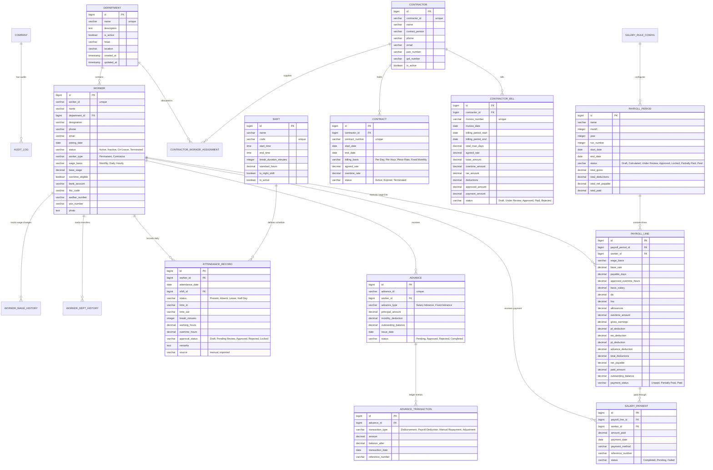

# PaySphere Database Schema & ERD Specification

This document details the complete relational database architecture designed for the PaySphere HR, Attendance, Contractor, and Payroll Management System.

---

## 1. Entity Relationship Diagram (ERD)

---

## 2. Table Specifications & Constraints

### 1. `departments_department`
| Field | Type | Constraints | Description |
| :--- | :--- | :--- | :--- |
| `id` | BigAutoField | Primary Key | Auto-increment identifier |
| `name` | CharField(100) | Unique, Not Null | Unique Department Name |
| `description` | TextField | Blank, Default '' | Department description |
| `is_active` | BooleanField | Default True | Active status |
| `head` | CharField(150) | Blank, Default '' | Department Head / In-charge |
| `location` | CharField(200) | Blank, Default '' | Plant Bay, Floor, or physical unit |
| `created_at` | DateTimeField | auto_now_add | Creation timestamp |
| `updated_at` | DateTimeField | auto_now | Last modification timestamp |

---

### 2. `workers_worker`
| Field | Type | Constraints | Description |
| :--- | :--- | :--- | :--- |
| `id` | BigAutoField | Primary Key | Auto-increment identifier |
| `worker_id` | CharField(50) | Unique, Indexed | Unique Worker Code (e.g. W001) |
| `name` | CharField(150) | Not Null | Full legal name |
| `department_id` | ForeignKey | Null, on_delete=SET_NULL | Assigned Department |
| `designation` | CharField(100) | Blank, Default '' | Job role |
| `phone` | CharField(25) | Blank, Default '' | Contact phone number |
| `email` | EmailField | Blank, Default '' | Contact email address |
| `joining_date` | DateField | Null, Blank | Organization joining date |
| `status` | CharField(20) | Choices, Default 'Active' | Active, Inactive, On Leave, Terminated |
| `worker_type` | CharField(50) | Choices, Default 'Permanent' | Permanent or Contractor |
| `wage_basis` | CharField(20) | Choices, Default 'Monthly' | Monthly, Daily, or Hourly |
| `base_wage` | DecimalField(10,2) | Default 25000.00 | Base monthly or daily wage |
| `overtime_eligible` | BooleanField | Default True | Overtime pay eligibility |
| `bank_account` | CharField(50) | Blank, Default '' | Bank account number |
| `ifsc_code` | CharField(20) | Blank, Default '' | Bank IFSC code |
| `aadhar_number` | CharField(30) | Blank, Default '' | Government Aadhar identity |
| `pan_number` | CharField(20) | Blank, Default '' | Income Tax PAN number |

---

### 3. `attendance_attendancerecord`
| Field | Type | Constraints | Description |
| :--- | :--- | :--- | :--- |
| `id` | BigAutoField | Primary Key | Auto-increment identifier |
| `worker_id` | ForeignKey | on_delete=CASCADE | Worker link |
| `attendance_date`| DateField | Indexed | Date of attendance |
| `shift_id` | ForeignKey | Null, on_delete=SET_NULL | Applicable Shift |
| `status` | CharField(20) | Choices | Present, Absent, Leave, Half Day |
| `time_in` | CharField(20) | Blank | Clock in time (e.g. '08:00 AM') |
| `time_out` | CharField(20) | Blank | Clock out time (e.g. '05:00 PM') |
| `break_minutes` | IntegerField | Default 60 | Unpaid break duration |
| `working_hours` | DecimalField(5,2)| Default 0.00 | Calculated net working hours |
| `overtime_hours`| DecimalField(5,2)| Default 0.00 | Approved eligible overtime hours |
| `approval_status`| CharField(20) | Choices, Indexed | Draft, Pending Review, Approved, Locked |
| `source` | CharField(20) | Choices | 'manual' or 'imported' |
| `approved_by_id`| ForeignKey | Null, on_delete=SET_NULL | User who approved |
| **Unique Constraint** | `[worker_id, attendance_date]` | Unique index | Prevents duplicate worker entries per date |

---

### 4. `payroll_payrollperiod` & `payroll_payrollline`
- `payroll_payrollperiod`:
  - **Unique Constraint:** `[month, year, run_number]`
  - Fields: `total_gross`, `total_deductions`, `total_net_payable`, `total_paid`, `status`
- `payroll_payrollline`:
  - **Unique Constraint:** `[payroll_period_id, worker_id]`
  - Fields: `payable_days`, `approved_overtime_hours`, `basic_salary`, `da`, `hra`, `allowances`, `overtime_amount`, `gross_earnings`, `pf_deduction`, `esi_deduction`, `pt_deduction`, `advance_deduction`, `total_deductions`, `net_payable`, `paid_amount`, `outstanding_balance`, `payment_status`.

---

### 5. `advances_advance` & `advances_advancetransaction`
- `advances_advance`:
  - Unique field: `advance_id`
  - Balance safety: `record_repayment()` prevents repayment > `outstanding_balance`.
- `advances_advancetransaction`:
  - Immutable audit ledger tracking every disbursement, payroll recovery, and adjustment with `balance_after`.
