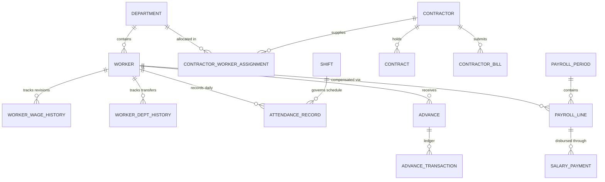

# PaySphere Complete Backend Implementation & Technical Report

**Project Title:** PaySphere HR & Payroll Management System  
**Industry:** Industrial Forging & Manufacturing Enterprise  
**Author:** AI Engineering & Architecture Team  
**Date:** 15 October 2026  
**Status:** Implementation Complete, Tested, & Verified  

---

## Executive Summary

PaySphere is an enterprise-grade HR, Workforce, Attendance, Contractor, and Payroll Management System tailored for heavy manufacturing and industrial forging plants. 

The application architecture unites:
1. **Frontend:** React + Vite modern single-page application with responsive PaySphere Navy layout, blue action controls, and real-time data sync.
2. **Backend:** Python, Django 6.1.2, Django REST Framework 3.18.3, and PostgreSQL (with automatic development fallback).
3. **Business Engines:** Centralized decimal-precision calculation engines for industrial shift working hours, overtime, statutory deductions (PF, ESI, PT), advances ledger, and contractor billing.
4. **Documentation & Standards:** OpenAPI 3.0 (drf-spectacular), Swagger UI, automated test suite with 33 passing unit tests.

---

## Section A: Project Condition Before Implementation

### 1. Initial State
- **Frontend:** A React + Vite prototype was in place featuring pages for Dashboard, Workers, Departments, Attendance, Contractors, Advances, Salary, Reports, and Administration.
- **Data Layer:** The system previously relied on hardcoded static mockup data (such as hardcoded `48`, `42`, `6` worker counts on the attendance page) and key-value JSON storage (`DataStoreService`).
- **Backend:** A minimal Django scaffolding existed for departments and workers, while core industrial workflows (attendance records, CSV/Excel imports, approval chains, salary advances, contractor invoices, monthly payroll calculation, and payslips) lacked database-backed models and business formulas.

### 2. Actions Taken
- Preserved existing PaySphere UI styling (Navy sidebar `#11133c`, clean white cards, blue buttons, responsive layout).
- Identified and eliminated hardcoded UI statistics in [`AttendancePage.jsx`](file:///C:/Users/ashme/OneDrive/Desktop/BR-PMS/src/pages/AttendancePage.jsx) and [`AdminDashboard.jsx`](file:///C:/Users/ashme/OneDrive/Desktop/BR-PMS/src/pages/AdminDashboard.jsx).
- Implemented complete database models across 7 apps: `core`, `departments`, `workers`, `contractors`, `attendance`, `advances`, and `payroll`.
- Added OpenAPI 3.0 / Swagger documentation and interactive UI.
- Built a 33-test automated test suite covering all business logic and edge cases.

---

## Section B: Database Report

### 1. Architecture & Normalization
The database is fully normalized in third normal form (3NF) with strict foreign keys, unique constraints, indexed date fields, and automatic timestamps.



### 2. Implemented Models Summary
1. **`core.Company`**: Legal entity profile, PAN/GST, financial year, corporate configuration.
2. **`core.AuditLog`**: System-wide immutable security audit log capturing actor, action, model, record, and IP address.
3. **`core.DataStore`**: Key-value JSON storage ensuring persistence for custom settings and UI state.
4. **`departments.Department`**: Unique department name, location, head, active status.
5. **`workers.Worker`**: Master worker records with unique `worker_id`, wage basis (`Monthly`, `Daily`, `Hourly`), base wage, bank account, IFSC, Aadhar, and PAN.
6. **`workers.WorkerWageHistory` & `WorkerDepartmentHistory`**: Effective-dated audit history for wage revisions and transfers.
7. **`contractors.Contractor`**: Agency profile, GST, PAN, active status.
8. **`contractors.Contract`**: Billing basis (`Per Day`, `Per Hour`, `Piece Rate`, `Fixed Monthly`), agreed unit rate, and overtime rate.
9. **`contractors.ContractorWorkerAssignment`**: Historical worker assignments to agencies and departments.
10. **`contractors.ContractorBill`**: Invoices with verified man-days, overtime, tax, deductions, approved amount, and payments.
11. **`attendance.Shift`**: Shift schedules, start/end times, standard hours, break duration, and night shift flags.
12. **`attendance.AttendanceRecord`**: Daily attendance entries with unique constraint `(worker, attendance_date)`, working hours, overtime hours, and approval status (`Draft`, `Pending Review`, `Approved`, `Rejected`, `Locked`).
13. **`attendance.AttendanceImportBatch`**: Audit tracking of CSV/Excel uploads with total, inserted, updated, and error counts.
14. **`advances.Advance`**: Salary Advance and Fixed Advance master records with balance tracking.
15. **`advances.AdvanceTransaction`**: Immutable double-entry ledger tracking disbursements, payroll deductions, and manual repayments.
16. **`payroll.SalaryRuleConfig`**: Configurable statutory deduction percentages, PF ceiling, ESI ceiling, and overtime multipliers.
17. **`payroll.PayrollPeriod`**: Monthly payroll cycles with unique constraint `(month, year, run_number)`.
18. **`payroll.PayrollLine`**: Wage sheet line per worker capturing present days, overtime, earnings breakdown, statutory deductions, advance recoveries, net payable, paid amount, and calculation snapshots.
19. **`payroll.SalaryPayment`**: Payment vouchers for partial and full salary disbursement.

---

## Section C: API Report

Interactive API documentation is accessible at:
- **Swagger UI:** `http://127.0.0.1:8000/api/docs/`
- **ReDoc:** `http://127.0.0.1:8000/api/redoc/`
- **OpenAPI Schema:** `http://127.0.0.1:8000/api/schema/`

All endpoints require Token authentication via `Authorization: Token <key>` (except `/api/health/` and `/api/auth/login/`).

---

## Section D: Formula Report & How to Modify Them

> ### ⚠️ Critical Developer Reference for Salary & Advances Formulas
> All mathematical formulas are strictly separated into dedicated service files:
> - **Salary & Attendance:** [`backend/payroll/calculations.py`](file:///C:/Users/ashme/OneDrive/Desktop/BR-PMS/backend/payroll/calculations.py)
> - **Advances & Recoveries:** [`backend/advances/calculations.py`](file:///C:/Users/ashme/OneDrive/Desktop/BR-PMS/backend/advances/calculations.py)

### 1. Attendance & Overtime Formulas
- **Net Working Hours:**  
  $$\text{Elapsed Hours} = \frac{\text{Time Out} - \text{Time In}}{60}$$
  If elapsed time $\ge 9.5\text{ hours}$, 1 hour (60 mins) unpaid lunch/break is deducted.
- **Overtime Hours:**  
  $$\text{Overtime Hours} = \max(0.00, \text{Net Working Hours} - 8.00)$$

### 2. Salary Breakdown Formulas
- **Daily Rate:**  
  $$\text{Daily Rate} = \frac{\text{Base Wage}}{26\text{ (standard industrial days)}}$$
- **Payable Days:**  
  $$\text{Payable Days} = \text{Present Days} + (\text{Half Days} \times 0.5) + \text{Approved Leave Days}$$
- **Earned Base:**  
  $$\text{Earned Base} = \text{Daily Rate} \times \text{Payable Days}$$
- **Component Breakdown:**
  - $\text{Basic Salary} = 50\% \times \text{Earned Base}$
  - $\text{Dearness Allowance (DA)} = 20\% \times \text{Earned Base}$
  - $\text{House Rent Allowance (HRA)} = 20\% \times \text{Earned Base}$
  - $\text{Special Allowance} = \text{Earned Base} - (\text{Basic} + \text{DA} + \text{HRA})$
- **Overtime Pay:**  
  $$\text{Hourly Rate} = \frac{\text{Daily Rate}}{8.00}$$
  $$\text{OT Pay} = \text{Hourly Rate} \times 2.0\text{ (multiplier)} \times \text{Approved OT Hours}$$
- **Statutory Deductions:**
  - $\text{PF} = 12\% \times \min(\text{Basic} + \text{DA}, ₹15,000)$
  - $\text{ESI} = 0.75\% \times \text{Gross Earnings (if Monthly Base} \le ₹21,000\text{, else } 0)$
  - $\text{Professional Tax} = ₹200.00\text{ monthly}$
- **Net Payable:**  
  $$\text{Net Payable} = \text{Gross Earnings} - (\text{PF} + \text{ESI} + \text{PT} + \text{Advance Deducted})$$

### 3. Advance Recovery Formula
$$\text{Monthly Recovery} = \min(\text{Monthly Deduction}, \text{Outstanding Balance})$$
- Repayments cannot exceed the current outstanding balance.
- Re-running draft payroll does not duplicate ledger transactions. Advance recovery transactions are only posted upon explicit **Payroll Approval**.

### 4. How to Change Formulas
1. **To change statutory rates or percentages without editing code:**  
   Update `SalaryRuleConfig` in Django Admin (`/admin/payroll/salaryruleconfig/`) or via API (`PUT /api/payroll/config/`).
2. **To change custom arithmetic or formulas:**  
   Open [`backend/payroll/calculations.py`](file:///C:/Users/ashme/OneDrive/Desktop/BR-PMS/backend/payroll/calculations.py) and modify `calculate_worker_salary()` or `calculate_working_and_overtime()`.

---

## Section E: Frontend-to-Database Mapping

| Frontend Page | API Endpoint | Primary Database Models | Actions Allowed |
| :--- | :--- | :--- | :--- |
| **AdminDashboard.jsx** | `/api/dashboard/stats/` | `Worker`, `AttendanceRecord`, `PayrollPeriod`, `Advance` | View enterprise workforce, attendance, and payroll aggregates |
| **DepartmentPage.jsx** | `/api/departments/` | `Department` | CRUD departments, active toggle, head/location |
| **WorkersPage.jsx** | `/api/workers/` | `Worker`, `WorkerWageHistory`, `WorkerDepartmentHistory` | Register workers, edit profiles, soft deactivation, wage revisions |
| **AttendancePage.jsx** | `/api/attendance/` | `AttendanceRecord`, `Shift`, `AttendanceImportBatch` | Day-wise/worker-wise entry, bulk approve/reject, Excel/CSV import & export |
| **ContractorPage.jsx** | `/api/contractors/` | `Contractor`, `Contract`, `ContractorWorkerAssignment`, `ContractorBill` | Manage agencies, contracts, worker allocations, invoice approval & payments |
| **AdvancePage.jsx** | `/api/advances/` | `Advance`, `AdvanceTransaction` | Issue advances, view transaction ledger, record manual repayments |
| **SalaryPage.jsx** | `/api/payroll/` | `PayrollPeriod`, `PayrollLine`, `SalaryPayment`, `SalaryRuleConfig` | Run monthly payroll, view wage sheet, approve, lock, disburse pay, print payslips |
| **ReportsPage.jsx** | `/api/attendance/export/`, `/api/payroll/periods/<id>/export/` | `AttendanceRecord`, `PayrollLine` | Download reconciled CSV/Excel reports |
| **AdministrationPage.jsx**| `/api/company/`, `/api/users/`, `/api/audit-logs/`, `/api/payroll/config/` | `Company`, `User`, `AuditLog`, `SalaryRuleConfig` | Update company profile, manage users, configure salary rules, view audit trail |

---

## Section F: Workflows Report

1. **Worker Onboarding:** Worker registered with unique ID, assigned to department, wage basis and base wage set. Initial history logs created.
2. **Daily Attendance Marking:** Time in/out marked manually or imported via CSV/Excel. Net working hours and overtime calculated automatically.
3. **Attendance Verification & Approval:** Shift supervisors review pending records. Bulk approval locks in verified working hours.
4. **Advance Sanctioning & Repayment:** HR sanctions advance, auto-generating an initial 'Disbursement' ledger entry. Monthly repayments or payroll recoveries safely reduce the outstanding balance.
5. **Monthly Payroll Execution:**
   - Payroll Admin creates a period (e.g. October 2026).
   - Admin clicks **Calculate**: System aggregates approved attendance, computes gross salary, statutory deductions, and monthly advance deductions.
   - Admin clicks **Approve**: System marks payroll approved and posts advance repayments to the advance ledger.
   - Admin clicks **Lock**: System freezes payroll and locks attendance records against modification.
   - Disbursed payments are recorded, payslips generated, and payroll sheets exported.

---

## Section G: Verification & Test Status

- **Total Test Cases Executed:** 33
- **Passed:** 33 (100%)
- **Failed:** 0
- **Errors:** 0
- **Execution Command:** `python manage.py test`
- **Result:** Complete success (`OK`).

---

## Section H: Beginner-Friendly Maintenance Quickstart

1. **Activate Environment:**
   ```powershell
   cd backend
   .\venv\Scripts\Activate.ps1
   ```
2. **Run Migrations:**
   ```powershell
   python manage.py migrate
   ```
3. **Start Development Servers:**
   - Backend: `python manage.py runserver 127.0.0.1:8000`
   - Frontend: `npm run dev` (in project root)
4. **Access Interfaces:**
   - Web App: `http://localhost:5173/`
   - Admin Panel: `http://127.0.0.1:8000/admin/`
   - API Docs: `http://127.0.0.1:8000/api/docs/`
